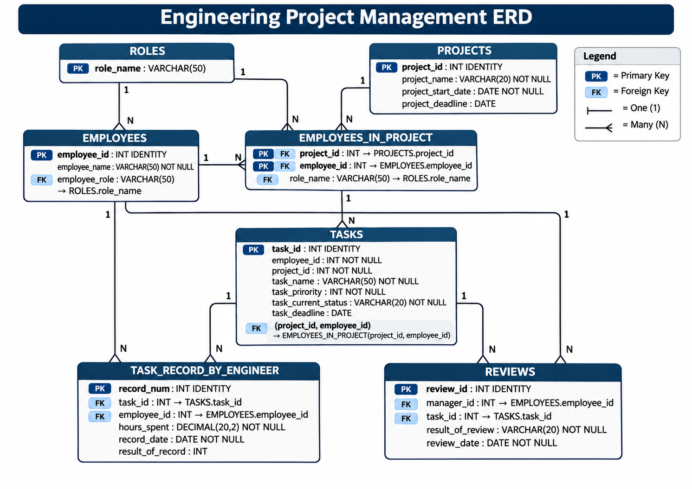

# Engineering Project Management Database

A SQL Server database for tracking engineering projects: who works on what, how many hours each task takes, and whether managers approve the result. It comes with a reproducible synthetic dataset for writing analytical queries and building KPIs, and a validation suite.

All people, projects, and activity in the dataset are fictional.

## Project overview

The database follows the life of a task in an engineering organization:

1. **Plan:** a project gets a start date, an optional deadline, and a team of employees, each with a role on that project.
2. **Assign:** each task goes to a member of the project team, with a priority, a status, and an optional deadline.
3. **Work:** engineers log work records with the hours spent and the number of defects found.
4. **Review:** a manager approves or rejects the task. A rejected task goes back for more work and another review.

Triggers enforce the main business rules inside the database, so invalid data is rejected when it's written. This structure supports questions about workload, delivery, and quality, such as which projects are behind, who is overloaded, and how often work passes review the first time.

The project has three parts:

- **Database:** the schema and its business rules.
- **Sample data:** a generated dataset of 13 projects, 30 employees, and 308 tasks, including deliberate patterns and edge cases.
- **Validation:** an automated suite that rebuilds the database from scratch and checks both the data and the rules.

## Data model



`database.sql` is the source of truth for names and types.

| Table | Purpose |
|-------|---------|
| `PROJECTS` | Projects with a start date and an optional deadline |
| `ROLES` | Job roles |
| `EMPLOYEES` | Employees and their role |
| `EMPLOYEES_IN_PROJECT` | Project membership and the role held on each project |
| `TASKS` | Tasks assigned to a project member, with priority, status, and an optional deadline |
| `TASK_RECORD_BY_ENGINEER` | Work log: hours spent on a task and the result of each session |
| `REVIEWS` | Manager reviews of tasks, either `Approved` or `Rejected` |

### Rules enforced by triggers

| Trigger | Rule |
|---------|------|
| `trg_task_deadline` | A task deadline can't be later than its project deadline |
| `trg_record_date` | A work record must fall within its project's dates |
| `trg_manager_review` | Only a manager can review a task |
| `trg_review_date` | A task must have a work record on or before the review date |
| `trg_project_deadline` | A project deadline can't move earlier than any of its task deadlines |

## Quick start

**Requirements:** Docker, and `sqlcmd` on your machine.

1. Set a strong password in your shell, and start SQL Server on your machine only:

   ```bash
   export SQLCMDPASSWORD='<your-strong-password>'

   docker run -d --platform linux/amd64 --name project-db \
     -e ACCEPT_EULA=Y -e MSSQL_SA_PASSWORD="$SQLCMDPASSWORD" \
     -p 127.0.0.1:1433:1433 \
     mcr.microsoft.com/mssql/server:2025-latest
   ```

2. Wait about 30 seconds for the server to start, then load the schema and the data:

   ```bash
   sqlcmd -C -S localhost,1433 -U sa -Q "CREATE DATABASE project_db;"
   sqlcmd -C -b -S localhost,1433 -U sa -d project_db -i database.sql
   sqlcmd -C -b -S localhost,1433 -U sa -d project_db -i seed_data.sql
   ```

3. Check that the data loaded. This query should return 308:

   ```bash
   sqlcmd -C -S localhost,1433 -U sa -d project_db -Q "SELECT COUNT(*) FROM TASKS;"
   ```

## Sample data

| Table | Rows |
|-------|------|
| `ROLES` | 7 |
| `EMPLOYEES` | 30 |
| `PROJECTS` | 13 |
| `EMPLOYEES_IN_PROJECT` | 72 |
| `TASKS` | 308 |
| `TASK_RECORD_BY_ENGINEER` | 1,263 |
| `REVIEWS` | 366 |

`scripts/generate_seed.py` generates the data with a fixed random seed, so the same script always produces the same file.

### Conventions

- **Snapshot date:** the data is a snapshot from `2026-11-02`. Use that date instead of `GETDATE()` so results stay stable.
- **Record result:** `result_of_record` is the number of defects found, so 0 means clean.
- **Priority:** `task_priority` runs from 1 (highest) to 5.
- **Completed task:** a task whose current status is `Completed`. Five of these have no review yet.
- **Overdue task:** a task that isn't `Completed` and has a deadline before the snapshot date. A task with no deadline is never overdue.

### Patterns to find

The generator builds in some patterns for analysis to uncover:

- Logistics Platform is the project in trouble: only 32.1% of its approved tasks were approved on time.
- Idan Rosen has a much higher rejection rate than other engineers, at 59.4%.
- Noa Shapira is overloaded, with 40 tasks.
- Higher-priority tasks take more hours per work record: 5.41 on average at priority 1, down to 2.56 at priority 5.

The data also includes edge cases, such as `NULL` values, zero-hour records, and a project with no team. The [validation protocol](docs/VALIDATION.md#edge-cases-9-checks) lists them all.

### KPI limitations

The schema has no task completion date, planned hours, cost, or status history. KPIs that depend on those need approximating or a schema change. For example, on-time delivery here uses the approval date in place of a completion date.

## Validation

```bash
./validation/validate.sh
```

This builds the database in a throwaway container, then runs the data checks and tests the triggers with rule violations. See the [validation protocol](docs/VALIDATION.md) for the steps, pass criteria, latest result, and known schema gaps.

## Repository layout

```text
.
├── database.sql       Tables, constraints, and triggers
├── seed_data.sql      Generated sample data
├── queries.sql        Analytical queries, commented out; uncomment one to run it
├── docs/              Validation protocol and entity relationship diagram
├── scripts/           Sample data generator
└── validation/        Validation script and its SQL checks
```

Each folder has its own README that explains its contents:

- [docs/](docs/README.md)
- [scripts/](scripts/README.md)
- [validation/](validation/README.md)
